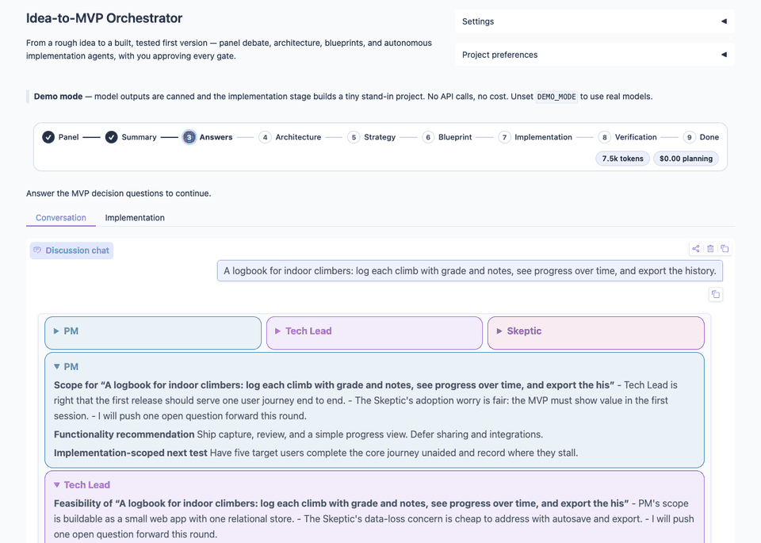

# Idea-to-MVP Orchestrator

[](https://github.com/alexandre0sheva/idea-to-mvp/actions/workflows/ci.yml)


[](LICENSE)

Turn a rough product idea into a **built, tested first version**. A LangGraph pipeline runs every stage with a dedicated agent: a multi-LLM panel debates the idea, an architect proposes options, a planner writes an agent-ready blueprint, and Claude Agent SDK agents implement the project in parallel and verify it. You approve every gate, and nothing that spends money runs without your say-so.



## Quick start (60 seconds)

You need [uv](https://docs.astral.sh/uv/); it installs the right Python (3.11 to 3.13) for you.

```bash
uv sync
DEMO_MODE=true uv run idea-to-mvp
```

To try it without cloning (once a release is on PyPI; until then add `--from git+https://github.com/alexandre0sheva/idea-to-mvp` after `uvx`, or after `pipx install` use the same URL in place of the name):

```bash
uvx idea-to-mvp                       # starts the UI; DEMO_MODE=true uvx idea-to-mvp for the offline walk-through
uvx idea-to-mvp run "a habit tracker" --autopilot
pipx install idea-to-mvp              # or install it once and keep the `idea-to-mvp` command
```

Settings come from the environment or a `.env` in the folder you run it from (the `.env.example` of this repository lists them all).

Demo mode walks the whole pipeline (panel, gates, blueprint pack, a stand-in implementation, verification, delivery report) with canned outputs: no API keys, no spend. Type an idea, or open **Settings** and switch **Autopilot** on to ride through the gates.

For a real run:

```bash
cp .env.example .env            # add OPENAI_API_KEY, ANTHROPIC_API_KEY, GOOGLE_API_KEY
uv run idea-to-mvp doctor       # checks keys, model IDs, and the agent CLI before you spend anything
uv run idea-to-mvp models       # every profile's models, prices, and the cost of a typical run
uv run idea-to-mvp
```

Without the UI, the same pipeline runs from the command line (progress on stderr, a summary or `--json` on stdout; exit code 0 verified, 2 delivered with failures, 3 stopped at a gate, 1 error):

```bash
DEMO_MODE=true uv run idea-to-mvp run "a habit tracker" --autopilot --implement
uv run idea-to-mvp run "a habit tracker" --autopilot   # stops at the implement gate and prints the cost estimate
uv run idea-to-mvp sessions                            # saved sessions, from the UI or the CLI
uv run idea-to-mvp resume <session> --implement --max-total-usd 10
uv run idea-to-mvp publish <session> --dry-run        # what would go to a new GitHub repository; creates nothing
```

Publishing is opt-in too: set `GITHUB_TOKEN` (or sign in with `gh`), then use the iterate gate's *Publish to GitHub* or `publish <session>`. It shows the repository (private by default) and exactly what would be pushed, and creates and pushes only after you confirm; `.idea-to-mvp/` and secret files never leave the project folder.

Agents are only started with an explicit `--implement`. `--answers FILE` and `--arch 1|2` answer those gates yourself; `resume <session> --implement --feedback "..."` builds the next version.

To measure a configuration end to end, `idea-to-mvp bench` runs the eight golden ideas headless and scores them (verified deliveries, acceptance pass rate, fix attempts, cost, wall time); `bench --compare runA runB` sets two runs side by side. It spends money, so a real run needs `--live --max-total-usd N` (`--dry-run` prices it first); `DEMO_MODE=true uv run idea-to-mvp bench --name smoke` runs it offline. See `CONTRIBUTING.md`.

Other agents can drive the pipeline too: `idea-to-mvp mcp` is an [MCP](https://modelcontextprotocol.io) server (stdio) with five tools, `start_run`, `get_status`, `answer_gate`, `list_sessions`, and `get_delivery`. Runs go on in the background, each gate is answered by naming it, and agent sessions start only when `answer_gate` gets `confirm_spend: true` at the implement gate, after the caller has shown you the cost estimate. Sessions are shared with the UI and the CLI.

```bash
claude mcp add idea-to-mvp -- uv run --directory /path/to/idea-to-mvp idea-to-mvp mcp      # Claude Code
```

For Claude Desktop add the same command to `claude_desktop_config.json`:

```json
{ "mcpServers": { "idea-to-mvp": { "command": "uv", "args": ["run", "--directory", "/path/to/idea-to-mvp", "idea-to-mvp", "mcp"] } } }
```

Add `"env": { "DEMO_MODE": "true" }` to try it offline. Keep your client's tool approval on for `answer_gate`; see `SECURITY.md`.

The implementation stage needs `ANTHROPIC_API_KEY` (it drives the Claude Agent SDK). Everything the app writes goes under `OUTPUT_DIR` (default `~/idea-to-mvp`, outside this repository).

`MODEL_PROFILE` picks the models of every role and agent session in one setting. Estimated cost of a typical run (a three-round panel and a three-task plan, from the prices in `src/idea_to_mvp/models.toml`; real runs vary):

| Profile | Models | Typical run |
|---|---|---|
| `fast` | the cheapest current models (Haiku 5.5, `gpt-6-luna`; `gemini-3.8-flash` for the Skeptic) | $0.17 |
| `balanced` (default) | Opus 5.5 plans, Sonnet 5.5 builds and verifies, Opus 5.5 takes merge conflicts and repeated fixes | $3.43 |
| `quality` | Opus 5.5 for the key panel roles, planning, and every agent session; Fable 5.1 for the hard cases | $5.47 |

## What you get

**Gates that ask the right question.** The MVP questions come prefilled with suggested answers; the architecture options sit side by side with a recommendation.


**Agents you can watch.** Independent plan tasks run in parallel git worktrees while a live board, log, and cost meter follow them.


**A delivery you can run.** Verification lanes for tests, quality, requirement coverage, and held-out acceptance tests the building agents never saw, a requirement-by-requirement table, how to run the project, a zip, a `v0.1` git tag, and a form to ask for v0.2.


**A verdict the agents cannot write themselves.** The orchestrator reads the test reports itself, flags a session that deleted or skipped a test, and fix attempts see what the earlier ones tried. Every blueprint pack carries an agent harness (a `CLAUDE.md`, one check script, project skills), which can optionally be tuned on a pilot task (`HARNESS_TUNING=pilot`), and each delivery adds a lesson to an experience library that the next project of the same stack reads.

## How it compares

An approach comparison, not a quality ranking: what each project's own README says it does, read on 2026-10-21 (they change, so check them). The measured results for this project are in [Benchmark](#benchmark).

| | idea-to-mvp | [MetaGPT](https://github.com/FoundationAgents/MetaGPT) | [GPT-Engineer](https://github.com/AntonOsika/gpt-engineer) | [OpenHands](https://github.com/All-Hands-AI/OpenHands) and Devin-style agents |
|---|---|---|---|---|
| **Starts from** | a rough idea; a panel of three models debates it | a one-line requirement; roles (product manager, architect, project manager, engineer) follow SOPs | a `prompt` file and the `gpte` command (the repository is archived and read-only since 2026-04-22) | a task given to a general coding agent in a canvas or a hosted product |
| **Where a human decides** | five gates: the MVP answers, the architecture, the blueprint, the spend, and each next version | the README describes none | the README describes none | you steer and review the agent; the OpenHands page describes no approval steps |
| **Hand-offs** | validated typed objects (strategy, plan, harness edits); a critic and a verify/fix loop | documents per role (user stories, requirements, APIs, ...) | one generated codebase | one agent session |
| **Where code runs** | an OS sandbox, a tool-call guard, a scrubbed environment, per-run cost caps, git worktrees per task | the README describes no isolation | the README describes no isolation | OpenHands offers Docker, VM, or host runtimes (host mode gives the agent your whole filesystem); hosted products run in their own cloud |
| **Is "done" true** | test reports the orchestrator parses itself, a test-integrity guard, and held-out acceptance tests the builders never see | the README reports no benchmark scores | the README does not say whether output is tested | the agent's own claim, unless you add checks |
| **Measured** | `idea-to-mvp bench`: verified deliveries per dollar over eight golden ideas, per model profile; the first live data point (one idea, two profiles) is below | no scores in the README | none in the README | none on the OpenHands page |

Devin-style products are closed, so only their approach is compared here.

## Benchmark

`idea-to-mvp bench` ran one golden idea, `link-shortener` (a Python, FastAPI, and SQLite service; it states its stack, so the build is repeatable), through the whole pipeline on real models with each profile. Same budget for both ($4 of agent spend and $1.50 per task), `EXECUTION_STRATEGY=agent_team`, `bypassPermissions` inside the sandbox, 2026-10-21, on commit `22ccfe6` plus the changes of this release. Everything is in [`docs/benchmarks/2026-10-21-22ccfe6/`](docs/benchmarks/2026-10-21-22ccfe6): each run's `config.json` and `results.json`, and the `bench --compare` output.

| Run | Profile | Verdict | Lanes | Fix attempts | Cost (planning + agents) | Time | Verified per $ |
|---|---|---|---|---|---|---|---|
| `fast-2` | `fast` | verified | 3/3 | 0 | $0.25 ($0.11 + $0.15) | 20 min | 3.93 |
| `balanced-3` | `balanced` | verified | 3/3 | 2 | $8.06 ($5.32 + $2.74) | 31 min | 0.12 |

What to take from it, and what not to:

- **One idea, one run per profile.** It shows that both profiles can deliver a verified service and what each costs on this idea; it cannot rank the profiles, and a difference of one run is within noise. `quality` was not run, and neither were the other seven ideas (`bench` runs them all when you pay for it).
- **The tests lane parsed real reports** (94 tests at 98% coverage for `fast`, 139 for `balanced`) and the requirements lane mapped every P0 requirement to a test. Neither run had held-out acceptance tests: the acceptance author wrote none, so the acceptance column of `bench` is empty. Treat "verified" as tests, lint, and requirement coverage, not as a check of the running service by an outside suite.
- **`balanced` planned much more.** Its documents are now complete (a 24 KB PRD with 33 requirements, 5 tasks, against 94 tests and 3 tasks for `fast`), which is most of its $5.32 of planning; the catalog's typical-run guess for `balanced` ($3.43) is well below what this run cost.
- **Time:** the first live run of the same kind (an idea with no stated stack, one serial lead session) took 51 minutes. With the plan built task by task in parallel worktrees and a smaller plan, these took 20 and 31 minutes.
- The runs that came before these were invalid and are kept, with why, under [`docs/benchmarks/2026-10-21-22ccfe6/`](docs/benchmarks/2026-10-21-22ccfe6) (`smoke-live`, `speed-1`, `invalid-budget-runs`): a sandbox that refused to let a lane start the project's server, a budget that built only the first task, and a model that spent its output cap on thinking and returned a truncated PRD. Each is fixed in this release.

## Examples

One complete run per profile, from the benchmark above (the blueprint pack the agents were given, the delivery report, the whole session as Markdown and JSON, and a dashboard screenshot): [`examples/link-shortener-fast`](examples/link-shortener-fast) and [`examples/link-shortener-balanced`](examples/link-shortener-balanced). `uv run python scripts/make_example.py --thread <session> --name <name>` makes one from any delivered session (`--demo "<idea>"` runs the offline demo first), and refuses to publish a file with a key-shaped string.

## The pipeline

```
Idea ─ (optional web research) ─→ Panel ─→ Summary + 5 MVP questions
  🔒 you answer  ─→ Architect: two options
  🔒 you choose  ─→ Strategy (and a starter template) ─→ Blueprint pack (PRD, architecture, plan, subagents, agent harness), reviewed by a critic
  🔒 you approve the blueprint and the spend
  ─→ Implementation (parallel tasks) ─→ Verification (4 lanes, fix loop) ─→ Delivery report
  🔁 ask for changes ─→ v0.2, same machinery
```

Every 🔒 is a real pause: the whole session is one checkpointed LangGraph thread, stored in SQLite, so you can close the app and pick up where you stopped.

## Why it's built this way

- **One durable graph with human gates.** `interrupt()` pauses and `Command(resume=...)` continues a single checkpointed thread, and the UI is a pure projection of that state, so restarts, Stop, and Continue need no extra bookkeeping.
- **Parallel where the work is independent.** `Send` fans out the panel's openings, the blueprint's documents, the plan's tasks (in git worktrees), and the verification lanes, each bounded by concurrency and budget caps.
- **Typed hand-offs and loops that check themselves.** Agents exchange validated Pydantic objects instead of prose, the plan is machine-checked, and a critic/revise loop and a verify/fix loop catch problems before you do.
- **Autonomous agents, but confined.** An OS sandbox, a tool-call guard, a scrubbed environment, and whole-run cost caps bound what the implementation agents can do; [SECURITY.md](SECURITY.md) says exactly what is and is not protected.
- **Offline-first, so it stays testable.** Every model call has a demo fixture, which lets CI run the entire pipeline (and the blueprint of each of the eight golden ideas) without a key.

## Learn more

- [docs/architecture.md](docs/architecture.md): the graph, the state contract, the LangGraph patterns used (each mapped to code and a test), and how to add an agent or a gate
- [.env.example](.env.example): every setting, with its default and meaning
- [SECURITY.md](SECURITY.md): the agent-execution threat model and how to report a vulnerability
- [CONTRIBUTING.md](CONTRIBUTING.md): development setup and quality checks
- [CHANGELOG.md](CHANGELOG.md): what changed, including upgrade notes
- [docs/roadmap.md](docs/roadmap.md): known limitations of this release and what comes next

Before a real implementation run, check `IMPLEMENTER_MAX_TOTAL_USD` (the whole-run cost cap); the implementation gate shows the agents' models, sandbox status, and budget before anything starts. Never commit `.env` or API keys.

## License

MIT. See [LICENSE](LICENSE).

## Credits

The agent harness in every blueprint pack, the behavioral-contrast tuning of it on a pilot task (Propose–Probe–Compose), the blind selection of the pilot builds, the experience library, and the evidence-boundary and answer-free prompt rules port ideas from Google Research's *Harness²: Recursive Agent Harnessing for an Open World* (Xu et al., [arXiv:2610.14224](https://arxiv.org/abs/2610.14224), Apache-2.0). The prompts and code here are this project's own; `docs/architecture.md` says how each idea maps to code.
