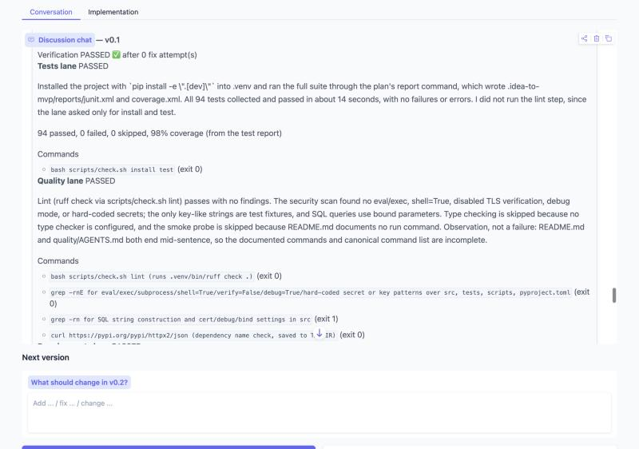

# Example: link-shortener-fast

> A small URL shortener service with an HTTP API: create a short link, redirect to the target, and count clicks per link.

This folder is a live run of idea-to-mvp, version v0.1. Verification passed (tests passed, quality passed, requirements passed).
Recorded model spend: $0.25. Profile fast (Haiku 5.5 builds and verifies); EXECUTION_STRATEGY=agent_team, the plan writer's scope budget, bypassPermissions inside the sandbox. Benchmark run fast-2.

| File | What it is |
|---|---|
| `blueprint/` | the blueprint pack the agents were given: PRD, architecture, plan, guides, agent harness |
| `DELIVERY_REPORT.md` | the delivery report: verdict per lane, requirements, how to run the project |
| `session.md`, `session.json` | the whole session as the chat showed it, from the idea to the report |
| `dashboard.png` | the delivery dashboard |

